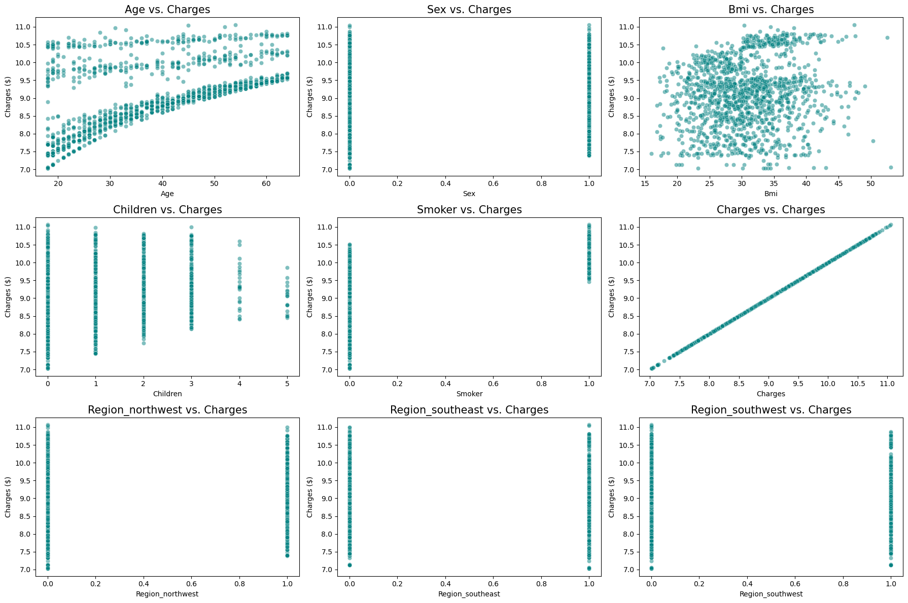
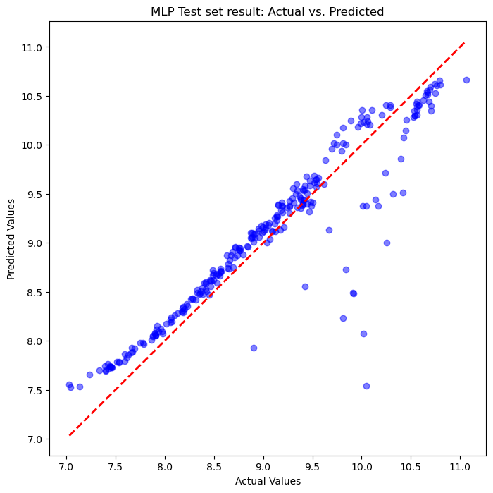
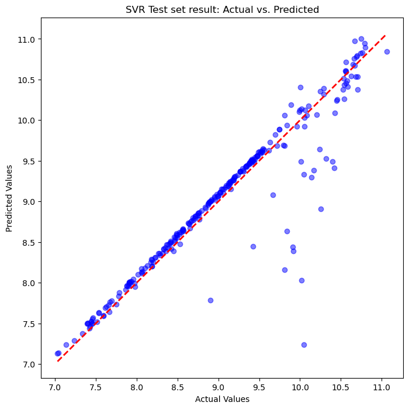

# Medical Insurance Cost Prediction: MLP vs SVR

Predicting individual medical insurance charges from customer demographics, comparing a **multi-layer perceptron (PyTorch + skorch)** with **support vector regression (scikit-learn)** under the same preprocessing, cross-validation and evaluation.



## Data and preprocessing

- 1,338 customers with 6 features (age, sex, BMI, number of children, smoker, region) and annual insurance **charges** as the target
- Binary encoding for sex and smoker; one-hot encoding for region, with one column dropped to avoid redundancy
- **Log-transformed target:** charges are highly skewed, and the log scale stabilises MLP gradient updates and gives SVR a consistent epsilon-tube width
- 80 / 20 train/test split
- `StandardScaler` placed **inside the model pipeline**, so scaling is learned only on each training fold (no leakage into validation folds)

## Models and tuning

Both models were tuned with **5-fold cross-validation grid search** on the training set.

| | MLP (PyTorch via skorch) | SVR (RBF kernel) |
|---|---|---|
| Grid size | 576 configurations | 240 configurations |
| Searched | layers, hidden units, activation, dropout, optimiser (Adam/SGD), learning rate, weight decay, batch size | C, epsilon, gamma, kernel |
| Best configuration | 3 hidden layers × 32 units, tanh, dropout 0.2, Adam (lr 1e-3), batch size 16 | C = 1000, epsilon = 0.1, gamma = 0.01 |
| Loss | RMSE on log-charges | epsilon-insensitive |

## Results (held-out test set)

| Metric | MLP | SVR |
|---|---|---|
| log-RMSE | 0.350 | **0.348** |
| R² | 0.864 | **0.865** |
| RMSE in original units | $4,811 | **$4,731** |
| Grid-search time | 8,942 s | **711 s** |
| Refit time (best model) | 15.5 s | **0.7 s** |

- **The two models perform almost identically.** Both explain about 86% of the variance in charges, and SVR is ahead by a margin too small to matter (about $80 RMSE).
- **SVR is far cheaper.** Its grid search was about 13× faster and its refit about 20× faster, so it's the more practical choice for a dataset of this size.
- **The MLP result varies slightly between runs.** PyTorch's seed is set in the notebook process, but the grid-search folds run in parallel worker processes that are not seeded, so repeating the search can select a slightly different architecture (one repeat chose 2 hidden layers instead of 3, with test R² 0.867). The two models remain within noise of each other either way; the SVR results are fully reproducible.

| MLP: actual vs predicted | SVR: actual vs predicted |
|---|---|
|  |  |

## Repository contents

| File | Purpose |
|---|---|
| `preprocessing.ipynb` | Exploratory analysis, encoding, log transform and train/test split; writes `X_train.csv`, `X_test.csv`, `y_train.csv`, `y_test.csv` |
| `mlp_vs_svr.ipynb` | Grid search, training, evaluation and visualisation for both models; saves the best models |
| `evaluate_saved_models.ipynb` | Loads the saved models and evaluates them on the test set without retraining |
| `best_mlp_model.pkl`, `best_svr_model.pkl` | The best trained models (pickled pipelines) |
| `figures/` | Plots used in this README |

## How to run

1. Download `insurance.csv` from the [Medical Cost Personal Dataset on Kaggle](https://www.kaggle.com/datasets/mirichoi0218/insurance) and place it in the repository root.
2. Install the dependencies:
   ```bash
   pip install -r requirements.txt
   ```
3. Run `preprocessing.ipynb`, then either `evaluate_saved_models.ipynb` (fast) or `mlp_vs_svr.ipynb` (full grid search; the MLP grid took about 2.5 hours).

> Only load pickle files you trust. These were created by this project's own training notebook.

## Tools

Python · PyTorch · skorch · scikit-learn · pandas · NumPy · Matplotlib · seaborn
